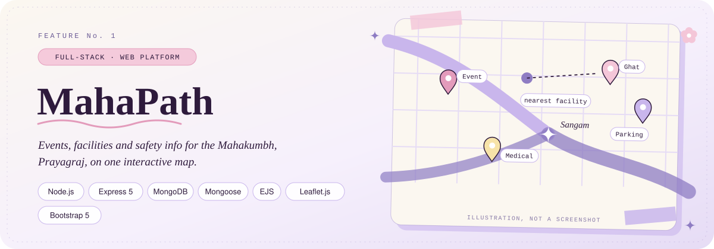
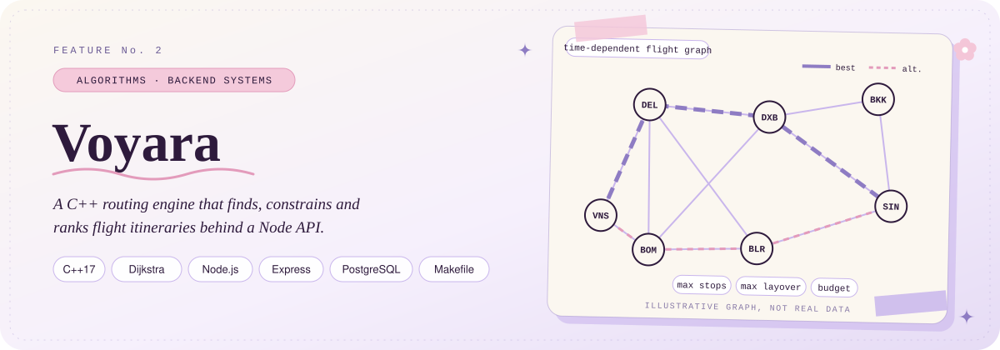
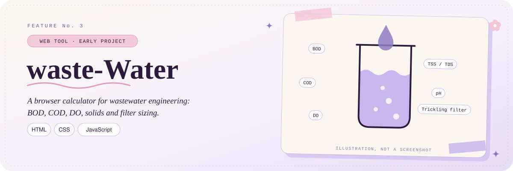
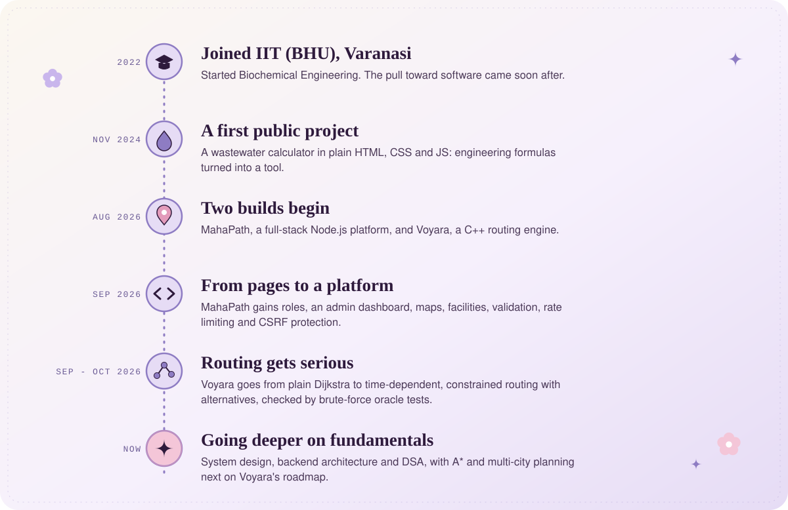
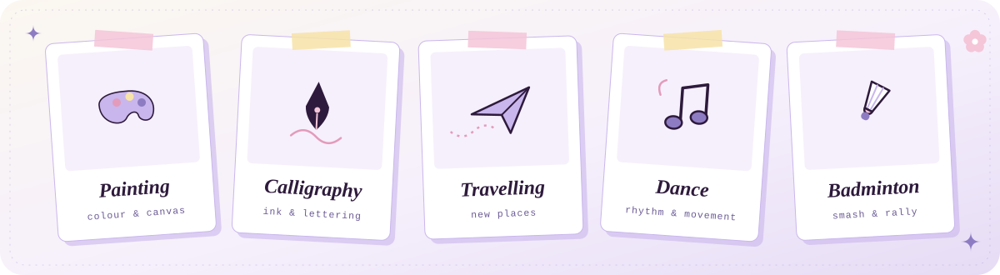

<!--
  TODO BEFORE PUBLISHING (search this file for "TODO"):
  1. LinkedIn + email links in the hero (commented out below)
  2. Optional: enable the contribution snake (see bottom of Analytics section)
  3. Optional: add a live-demo link for waste-Water once you enable GitHub Pages on YOUR repo
-->

 

*Building things, solving problems & figuring out how everything works.*

**[GitHub](https://github.com/amisha6604)**
<!-- TODO: add LinkedIn →  &nbsp;·&nbsp; **[LinkedIn](https://www.linkedin.com/in/YOUR-HANDLE)** -->
<!-- TODO: add email    →  &nbsp;·&nbsp; **[Email](mailto:YOUR-EMAIL)** -->

I'm a student at **IIT (BHU), Varanasi**, studying Biochemical Engineering, and I keep gravitating toward software. I like knowing how things work under the hood: why a shortest-path search picks the route it does, what a session cookie is actually protecting, how a map tile ends up on screen.

Lately that has meant building **MahaPath**, a full-stack discovery platform, and **Voyara**, a travel-routing engine written in C++. I'm aiming for software engineering roles where I can work across algorithms, backend systems and thoughtful design.

`Software development` `Algorithms` `Backend engineering` `System design`

<table>
  <tr><td><b>Studying</b></td><td>Biochemical Engineering, IIT (BHU) Varanasi, since 2022</td></tr>
  <tr><td><b>Interested in</b></td><td>Backend engineering, graph algorithms, system design</td></tr>
  <tr><td><b>Beyond the code</b></td><td>Painting, calligraphy, travelling, dance, badminton</td></tr>
</table>

**Toolbox** (only what's actually in my repositories)

<table>
  <tr><td><b>Languages</b></td><td><code>JavaScript</code> <code>C++17</code> <code>Python</code> <code>SQL</code> <code>HTML/CSS</code></td></tr>
  <tr><td><b>Backend</b></td><td><code>Node.js</code> <code>Express</code> <code>REST APIs</code> <code>Session auth</code> <code>bcrypt</code> <code>express-validator</code> <code>Rate limiting</code> <code>CSRF protection</code></td></tr>
  <tr><td><b>Databases</b></td><td><code>MongoDB</code> <code>Mongoose</code> <code>PostgreSQL</code></td></tr>
  <tr><td><b>Frontend</b></td><td><code>EJS</code> <code>Bootstrap 5</code> <code>Leaflet.js</code> <code>Vanilla JS</code></td></tr>
  <tr><td><b>Algorithms</b></td><td><code>Dijkstra</code> <code>Label-setting search</code> <code>Haversine distance</code> <code>Brute-force oracle testing</code></td></tr>
  <tr><td><b>Tools</b></td><td><code>Git &amp; GitHub</code> <code>Make / g++</code> <code>Faker (data seeding)</code></td></tr>
</table>

**The problem.** Mahakumbh is crowded, unfamiliar and time-sensitive. Visitors need events, facilities, safety information and help in one place instead of scattered across notice boards and word of mouth.

**What's in the code**
- **Accounts and roles:** session auth with bcrypt-hashed passwords, three roles (visitor, organizer, admin), an admin dashboard, pending-request management and an admin-assisted password reset.
- **Events and maps:** event CRUD, event detail pages with a location map, and an interactive Leaflet/OpenStreetMap view over 23 curated Prayagraj-area locations.
- **Nearest facility:** finds the closest hospital, police booth, parking or medical camp using Haversine distance.
- **Safety and help:** incidents, traffic advisories and diversions, crowd reports, lost & found, helplines, FAQs and a rule-based help chatbot.
- **Everything else:** global search, pagination, notification banners, text-size accessibility controls, and seeded demo content.
- **Hardening:** `express-validator` input validation, `express-rate-limit`, and custom CSRF-token middleware on state-changing forms.

**Engineering decisions** (from my own [`SYSTEM_DESIGN.md`](https://github.com/amisha6604/MahaPath/blob/main/SYSTEM_DESIGN.md))
- **MVC with server-rendered EJS** instead of a separate SPA: one codebase, one deploy, simpler session auth. The tradeoff is a less app-like feel.
- **One unified `Facility` model** with a `type` enum rather than five collections: no schema duplication, at the cost of slightly looser type-specific validation.
- **Append-only `CrowdReport`:** every report is a new document, so history is preserved and concurrent updates can't race. "Current" density is derived from the latest report.

**Status:** runs locally (Node + MongoDB). There is no public deployment yet.

[**View project →**](https://github.com/amisha6604/MahaPath)

 

**The problem.** Booking sites rank flights by one number. Voyara is an *algorithm-first* experiment: given flights and what a traveller cares about (money, time, number of stops), produce ranked, explainable itineraries that respect real constraints like connection times.

**What's implemented**
- **C++17 routing engine** on a flight graph with **time-dependent edges**: a connection is only valid if the next departure leaves after the previous arrival plus a minimum connection time.
- **Label-setting Dijkstra with dominance pruning**, optimizing either **price** or **elapsed journey time** (first departure to final arrival, layovers included).
- **Hard constraints:** budget, max stops, max travel time, min connection time and max layover.
- **Alternative itineraries:** returns up to 50 feasible candidates, ordered deterministically (rules documented in `docs/engine_search_semantics.md`).
- **Multi-objective scoring module** (cost, time, stops) with unit tests. It is not exposed through the API yet.
- **Node/Express API** (`/api/health`, `/api/flights`, `/api/route`) that runs the engine as a subprocess over a documented JSON protocol, backed by an 11-table **PostgreSQL** schema and seed loader.
- **Data:** 15 airports, 36 flights and 41 hotels of seed data, plus a generated 500-airport / 3,000-flight benchmark set.

**Testing.** One command (`make test`) builds the engine and runs scorer unit tests, 28 JSON fixture scenarios, and two **brute-force oracle checks** that compare the engine against exhaustive search on random networks, including candidate mode.

**An honest engineering call.** My decision log records that classic bitmask-DP TSP is a good DSA exercise but *not* a faithful model of real multi-city flight routing, which is time-aware. I'd rather build the right model than claim the neat one.

**Status:** actively in development.
**On the roadmap, not built yet:** A\* with a benchmark against Dijkstra, multi-city planning, and the React + Vite + Tailwind frontend. (The repo README lists these in its stack; the code today is the engine, API and data layer.)

[**View project →**](https://github.com/amisha6604/Voyara)

 

**What it does.** A browser-based wastewater engineering calculator, a small tool that turns lab and design formulas into inputs and results. Screens for **BOD** (multi-sample average with dilution), **organic solids** (TS/TDS/TSS/TVS/TFS from crucible weights), **COD** (FAS titration), **dissolved oxygen** (titration), a **water-fitness check** (pH, temperature, alkalinity, TDS), a **rotating biological contactor** and a **trickling filter**.

**Implementation.** Plain HTML, CSS and JavaScript, with no framework: a multi-screen UI driven by DOM events. It's an early project (built in November 2024, about 1,100 lines),, and an early step in turning engineering formulas into software.

[**View project →**](https://github.com/amisha6604/waste-Water)
<!-- TODO (optional): enable GitHub Pages on YOUR repo (Settings → Pages), then add:  &nbsp;·&nbsp; [**Live demo →**](https://amisha6604.github.io/waste-Water/) -->

<table>
  <tr><td width="24%"><b>Building</b></td><td><b>Voyara:</b> the C++ engine, most recently generating alternative feasible itineraries. <b>MahaPath:</b> polishing the platform and its seeded content.</td></tr>
  <tr><td><b>Learning</b></td><td>System design, backend architecture, DSA and problem-solving. I'm studying forks of <a href="https://github.com/amisha6604/system-design-primer">system-design-primer</a> and <a href="https://github.com/amisha6604/Complete-Python-Bootcamp">Complete-Python-Bootcamp</a> as learning material (not my own work).</td></tr>
  <tr><td><b>Recent challenge</b></td><td>Routing over a <i>time-dependent</i> flight graph. With connection and layover rules, the cheapest or fastest partial route isn't always the one worth keeping. Voyara keeps labels and prunes only dominated ones, then checks results against a brute-force oracle.</td></tr>
  <tr><td><b>Exploring next</b></td><td>A* and a benchmark against Dijkstra, multi-city planning, a React frontend for Voyara, and deploying MahaPath.</td></tr>
</table>

Last updated: November 2026. Edit the table above by hand whenever things change.

  
  

<!--
  OPTIONAL contribution snake (self-hosted, no third-party service at view time):
  1. Push .github/workflows/snake.yml, then Actions → "Generate Snake" → Run workflow.
  2. After it succeeds, uncomment the block below.

  

-->

Thanks for stopping by. Always happy to talk about algorithms, backend design or a good paintbrush.

